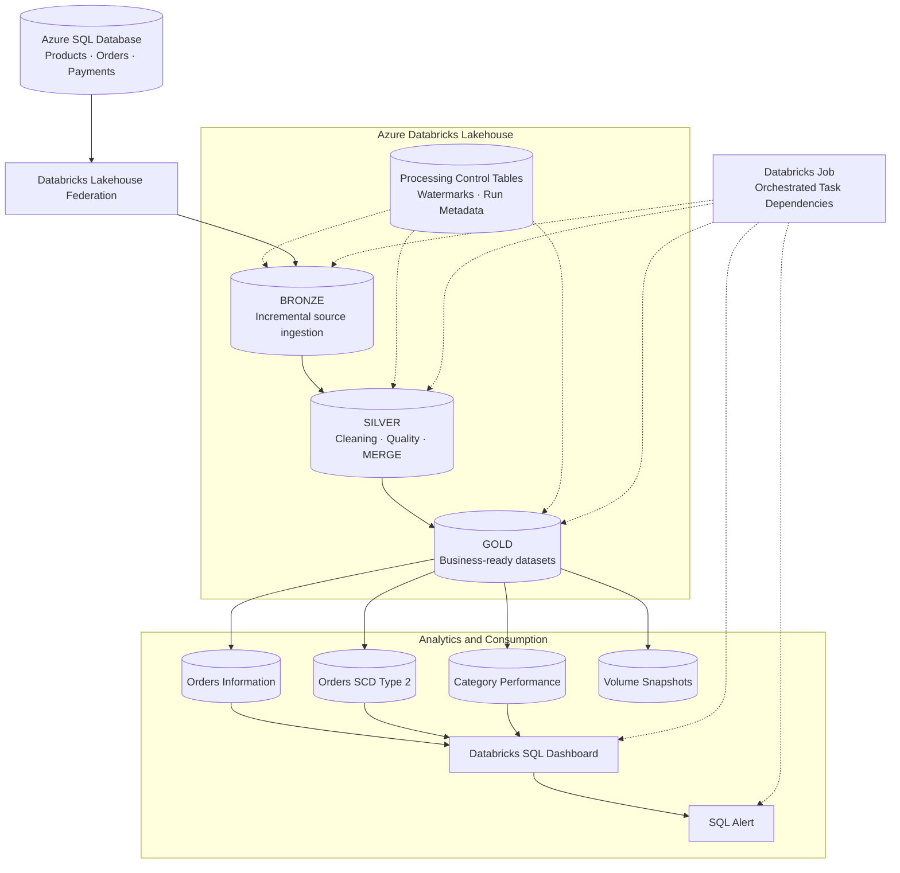

# NovaCart | Incremental Retail Data Engineering Platform

An end-to-end data engineering case study built with Azure SQL Database, Azure Databricks, Lakehouse Federation, Delta Lake, incremental processing, and stakeholder analytics.

NovaCart demonstrates how operational retail data can be transformed into structured, business-ready datasets through a layered lakehouse architecture, with orchestration and analytics outputs designed around repeatable processing.

> **Project status:** Implementation artifacts and configuration are preserved in this repository. The Azure Databricks workspace has been deleted to control costs; running the platform again requires recreating the necessary cloud resources and configuring the deployment.

## Table of Contents

- [Business Problem](#business-problem)
- [Solution Overview](#solution-overview)
- [Architecture](#architecture)
- [Technology Stack](#technology-stack)
- [Data Engineering Workflow](#data-engineering-workflow)
- [Gold Analytics](#gold-analytics)
- [Orchestration and Monitoring](#orchestration-and-monitoring)
- [Data Management and Reliability](#data-management-and-reliability)
- [Repository Structure](#repository-structure)
- [Deployment and Reproduction](#deployment-and-reproduction)
- [Security and Cost Management](#security-and-cost-management)
- [Engineering Decisions and Trade-offs](#engineering-decisions-and-trade-offs)
- [Limitations and Future Improvements](#limitations-and-future-improvements)

## Business Problem

Retail businesses often store operational data across related systems for products, orders, and payments. Reporting directly from operational tables can make it difficult to maintain consistent metrics, track changes over time, and provide stakeholders with a unified view of commercial performance.

NovaCart addresses this challenge through a layered data platform that separates ingestion, data preparation, business transformations, and analytical consumption.

The intended business outcomes are:

- A consolidated view of order and payment performance.
- Visibility into gross merchandise value (GMV) and payment completion.
- Category-level performance comparisons.
- Historical tracking of changes to order information.
- Repeatable processing that limits unnecessary reprocessing of unchanged records.

## Solution Overview

The platform uses Azure SQL Database as its operational source and Azure Databricks as the data processing and analytics environment.

Lakehouse Federation provides access to source data without relying on a conventional extract-and-load connector for the initial source access. The processing workflow then uses Bronze, Silver, and Gold layers built around Delta tables.

The Gold layer provides curated datasets for dashboard reporting and downstream consumption, with a Databricks Job configuration defining the processing sequence.

## Architecture



The diagram represents the intended processing architecture and the saved orchestration configuration. Cloud services must be recreated before the platform can run again.

## Technology Stack

| Area | Technology | Purpose |
|---|---|---|
| Operational source | Azure SQL Database | Products, orders and payments |
| Source access | Databricks Lakehouse Federation | Query access to source tables |
| Processing | Azure Databricks, Apache Spark | Distributed data transformations |
| Storage and table format | Delta Lake | Layered datasets and merge operations |
| Data modeling | PySpark, Spark SQL | Cleansing and business transformations |
| Incremental processing | Timestamp and primary-key watermarks | Track processing progress |
| Historical data | SCD Type 2 pattern | Preserve versions of order information |
| Orchestration | Databricks Jobs | Coordinate notebook and downstream tasks |
| Analytics | Databricks SQL dashboards | Stakeholder reporting |
| Monitoring | SQL alert configuration | Evaluate defined business or data thresholds |
| Artifact management | Git and GitHub | Version-controlled project files |

## Data Engineering Workflow

### 1. Source access and Bronze ingestion

The source contains three related entities:

- `products` — product attributes, categories, prices, and update timestamps.
- `orders` — order identifiers, customers, products, status, amounts, and timestamps.
- `payments` — payment identifiers, associated orders, payment status, amounts, and processing timestamps.

The Bronze notebook uses incremental processing with source-specific timestamp and primary-key tracking. An ingestion control table records processing state and row-write information.

The intended outcome is to capture newly available source records and changes without requiring a full reload on every run.

### 2. Silver transformation

The Silver workflow prepares the ingested data for downstream use through operations that include:

- Standardizing and cleaning source fields.
- Deduplicating records.
- Applying data-quality checks and handling invalid records.
- Using Delta `MERGE` operations to insert or update target records.
- Maintaining processing-control metadata.

The Silver layer separates data preparation from the business-specific logic in Gold.

### 3. Gold business modeling

The Gold notebook processes changes from the Silver layer and updates curated analytical datasets.

Its main outputs are:

- `orders_information` — order-level analytical information.
- `orders_information_scd2` — historical versions of order information.
- `category_performance` — category-level commercial and payment metrics.
- Latest and timestamped Parquet snapshots published to a Databricks Volume.

The implementation identifies affected orders and categories so that downstream processing can focus on impacted business entities.

## Gold Analytics

The Gold layer is designed to support practical retail reporting.

| Dataset | Purpose |
|---|---|
| Orders Information | Current-state order and payment analysis |
| Orders SCD Type 2 | Historical tracking of selected order attributes |
| Category Performance | Aggregated category-level metrics |
| Volume Snapshots | Published analytical extracts for downstream use |

### Business metrics

The category-performance model includes metrics such as:

- Total orders.
- Gross merchandise value (GMV).
- Paid amount.
- Average payment completion.
- Payment failure rate.

These measures can help stakeholders understand commercial activity and payment outcomes. Their business definitions, treatment of cancelled orders, and handling of partial or multiple payments should be documented alongside the relevant SQL logic.

## Orchestration and Monitoring

The repository contains a Databricks Job configuration named `novacart case study job`.

Its configured dependency chain is:

1. `bronze_work` — incremental source ingestion.
2. `silver_work` — cleaning, quality processing, and Delta merges.
3. `gold_work` — business transformations and aggregations.
4. `novacart_dashboard` — dashboard task.
5. `n_alert` — SQL alert task.

The saved configuration uses `ALL_SUCCESS` dependencies, so each downstream task is configured to run only after its prerequisite task succeeds.

The configuration also enables job queuing and sets `max_concurrent_runs` to `1`, preventing overlapping job runs within that job configuration.

The dashboard export and job configuration are included as project artifacts. Their presence does not mean that the deleted workspace or its live dashboard and alert resources are currently available.

## Data Management and Reliability

The implementation incorporates several patterns relevant to dependable data pipelines.

### Incremental state

Watermarks and processing-control tables record progress across processing runs. Source timestamp and primary-key fields are used for incremental ingestion, while downstream control state tracks Gold processing progress.

### Idempotent-style updates

Delta `MERGE` operations are used in the transformation workflow to insert or update matching target records. Correct idempotency still depends on stable keys, deterministic transformation logic, appropriate merge conditions, and correct checkpoint advancement.

### Historical tracking

The SCD Type 2 model is designed to preserve historical versions of selected order attributes rather than only overwriting the current record.

### Data quality

The Silver workflow includes cleaning, deduplication, and data-quality handling. A future extension should publish explicit quality metrics, quarantine counts, reconciliation outcomes, and failure summaries so that operational health can be assessed from recorded evidence.

## Repository Structure

```text
1NOVACART-CASE-STUDY/
├── README.md
├── bronze_work.ipynb
├── silver_work.ipynb
├── gold_work.ipynb
├── sql-tables-creation.sql
├── initial-load-for-mess-data.sql
├── IncrementalLoad-1.sql
├── IncrementalLoad-2.sql
├── NovaCart Sales & Payments Overview.lvdash.json
├── novacart_job.json
└── 1NOVACART-CASE-STUDY.zip
```

The files have different roles:

- **Notebooks:** layered processing logic.
- **SQL scripts:** source table definitions, initial data setup, and incremental-load examples.
- **Dashboard JSON:** exported dashboard artifact.
- **Job JSON:** saved orchestration configuration.
- **ZIP archive:** packaged project materials.

The ZIP archive is a convenience copy, not a replacement for maintaining the individual files.

## Deployment and Reproduction

The platform is not currently running because its Azure Databricks workspace was deleted to control costs.

Recreating the environment requires the appropriate Azure and Databricks resources, source data, permissions, configuration, and compute or SQL warehouse resources.

A high-level redeployment sequence is:

1. Provision Azure SQL Database and load the required source tables and data.
2. Create an Azure Databricks workspace and configure the required access to Azure SQL.
3. Configure Unity Catalog and Lakehouse Federation according to the environment's permissions and networking requirements.
4. Recreate the required catalog, schemas, control tables, Delta tables, and Volume.
5. Import the three notebooks and update environment-specific paths and configuration.
6. Execute Bronze, Silver, and Gold in dependency order.
7. Import or recreate the dashboard and SQL alert using supported Databricks interfaces.
8. Recreate the Databricks Job using `novacart_job.json`, updating resource identifiers and workspace-specific settings.
9. Run a controlled initial load, then validate subsequent incremental runs and analytical outputs.

The saved job JSON contains environment-specific identifiers and workspace paths. These must be updated for a new deployment; the file should not be assumed to be a portable, ready-to-run deployment bundle.

## Security and Cost Management

Before deploying the platform:

- Store credentials in an approved secret-management mechanism rather than notebooks or source control.
- Apply least-privilege access to source tables, catalogs, schemas, Volumes, dashboards, and job resources.
- Avoid publishing personal workspace paths, account identifiers, or private connection details.
- Set appropriate compute limits, schedules, and auto-termination policies.
- Review Azure Cost Management regularly.
- Stop or delete resources that are no longer required, after confirming that their data and configuration have been preserved.

The project is designed to be documented and redeployed when needed, rather than keeping paid infrastructure running solely for portfolio visibility.

## Engineering Decisions and Trade-offs

### Lakehouse Federation versus conventional ingestion

Federation provides direct access to source data without requiring a separate traditional extraction connector for that access path. It introduces dependencies on source availability, permissions, networking, and query performance.

### Timestamp-based incremental processing

Timestamp watermarks can reduce unnecessary reads, but correctness depends on source timestamp quality, timestamp ties, late-arriving updates, and the relationship between the watermark and primary key. These behaviors should be validated against the actual source and notebook logic.

### Delta MERGE versus append-only processing

Merge-based updates help maintain current-state target tables when source records change. They also introduce additional compute and require correct keys and deterministic matching logic.

### Current state versus historical state

The current-state Gold table supports straightforward reporting, while SCD Type 2 provides historical context at the cost of additional storage and more complex transformation logic.

### Incremental aggregation versus full recalculation

Processing affected categories can reduce repeated work, but it requires reliably identifying every category affected by changes to orders, products, or payments. A full reconciliation strategy remains useful for detecting drift.

## Limitations and Future Improvements

Potential next steps for strengthening the platform include:

- Automated regression tests for transformation logic and business rules.
- Explicit reconciliation between source, Bronze, Silver, and Gold.
- Failure injection and recovery tests for interrupted processing.
- Formal validation of watermark boundaries, timestamp ties, and late-arriving changes.
- Structured logging and operational metrics for pipeline runs.
- CI checks for notebook exports, SQL scripts, and configuration artifacts.
- Automated deployment of environment-specific resources.
- Data dictionaries and metric definitions for business stakeholders.
- Documented recovery procedures and a cost-aware redeployment guide.

These are improvement areas, not claims that every capability is already implemented.

## Project Deliverables

This repository preserves the main implementation artifacts for the NovaCart case study:

- Bronze, Silver, and Gold notebooks.
- SQL source and load scripts.
- Exported Databricks dashboard.
- Databricks Job configuration.
- Project documentation and architecture definition.

**Repository:** [github.com/viradidi/1NOVACART-CASE-STUDY](https://github.com/viradidi/1NOVACART-CASE-STUDY)

**Author:** Isaiah Nyakundi


